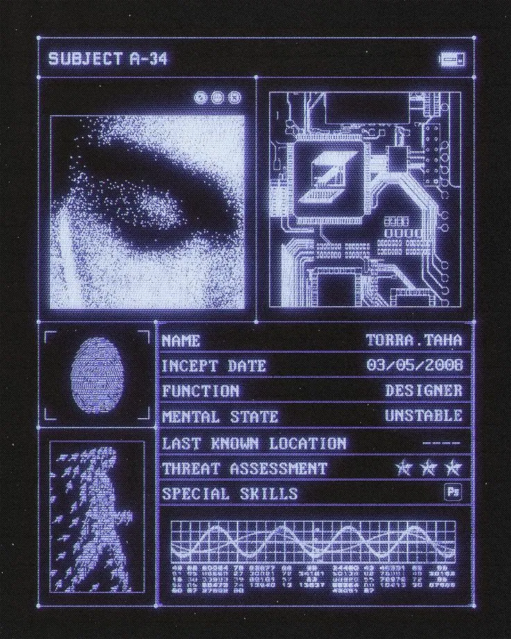
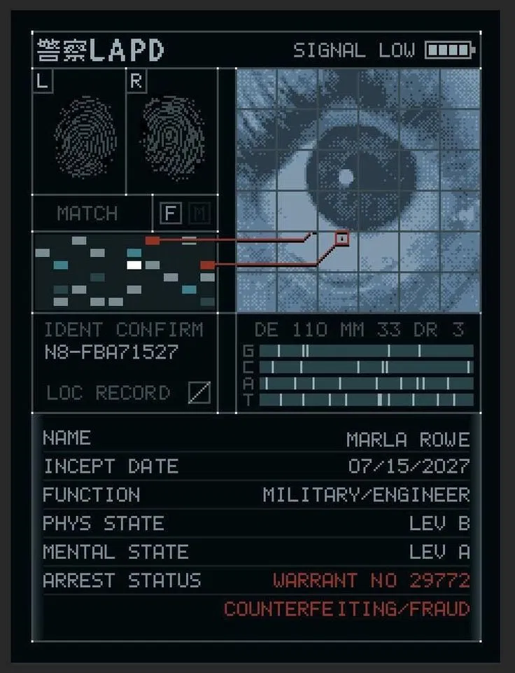
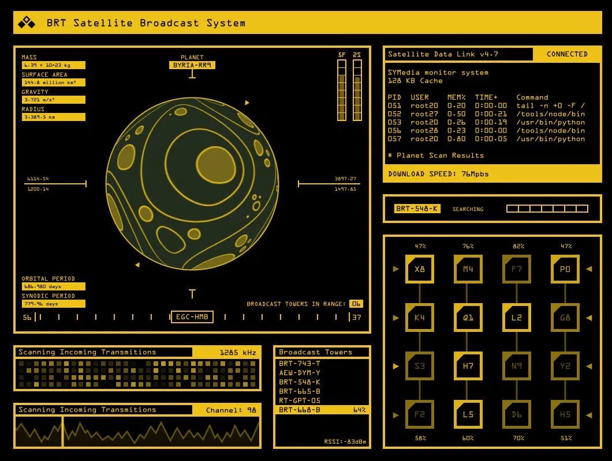
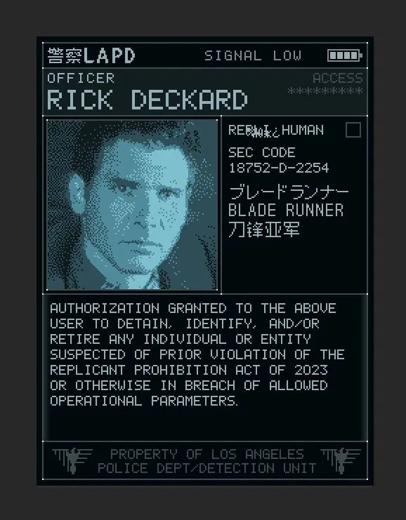
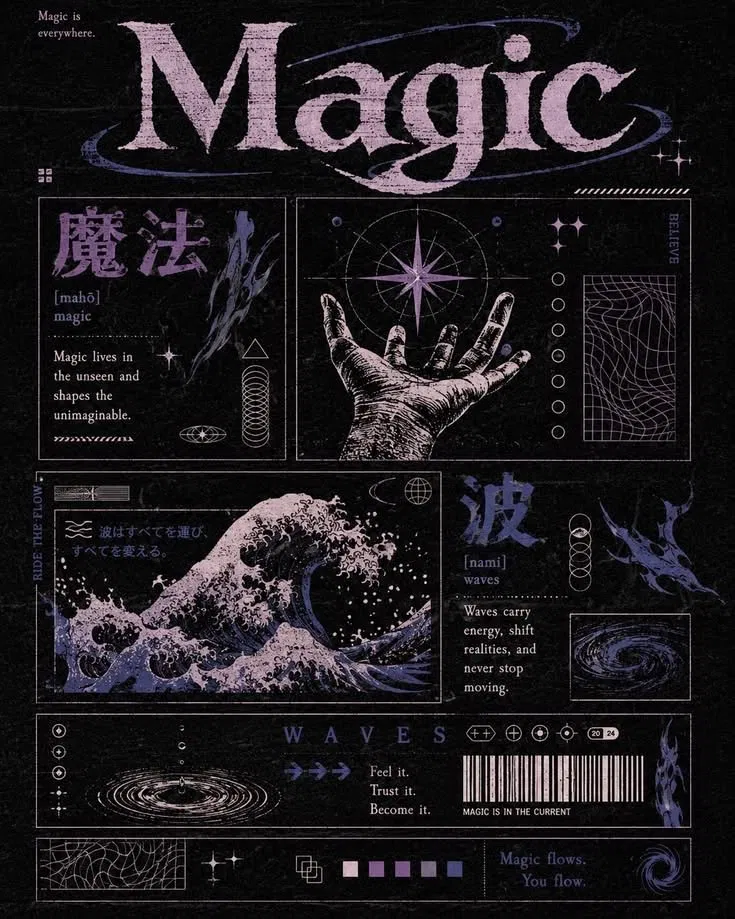
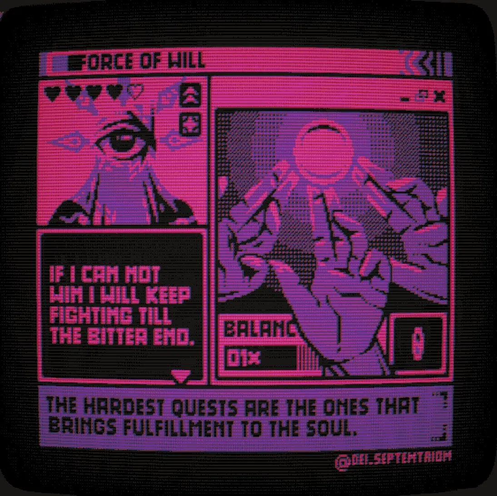
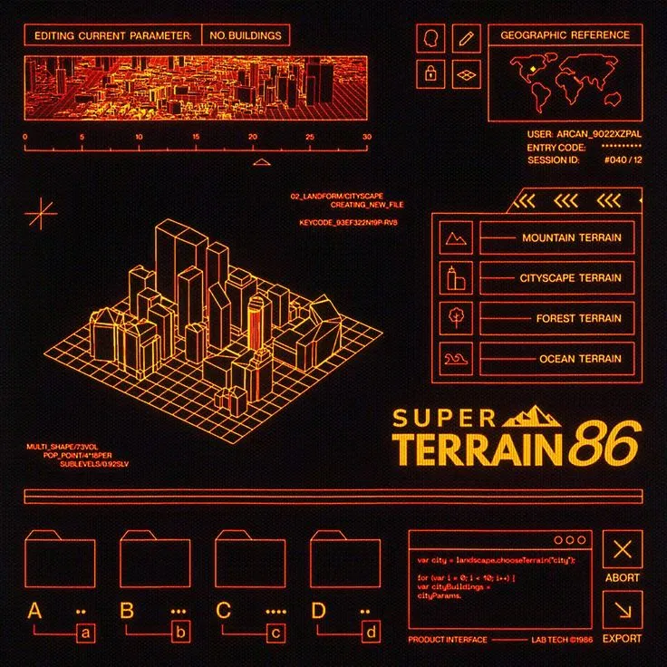
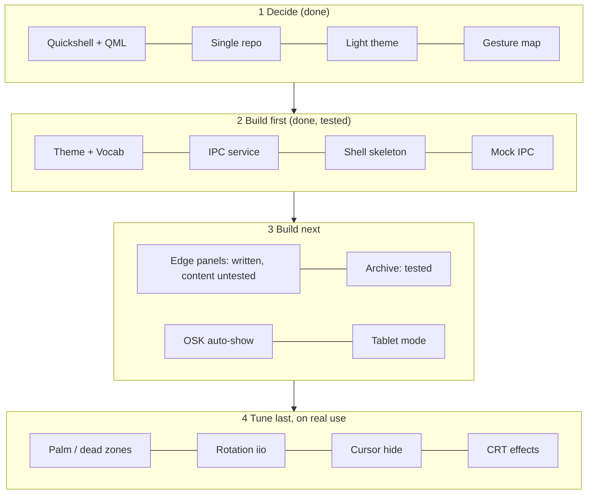

# Chronos handoff v16 (replaces v15)
User preference: write as little as possible. Reply in the user's language. Desktop `grep` is rg: use `command grep`.
[SANDBOX] has no rust/nix/quickshell: nothing is compiled or run there. [DESKTOP] = build machine (~/Proyectos/{chronos,MyNixOS}). [SURFACE] = test device (jano@192.168.9.111 at school, 192.168.0.115 at home; check with `hostname -I`).

## Decisions (final)
Stack and repo
- Shell: Quickshell + QML ("Chronos Terminal"), replaces dynisland (still installed, autostart off, retire later).
- WM: niri fork (Rust). Shell and WM live in ONE repo `~/Proyectos/chronos` (GitHub JANO-de/ChronosWM); NixOS config `~/Proyectos/MyNixOS` takes it as flake input `chronos`. Run flake commands only from `~/Proyectos/MyNixOS` (a stale `~/Documents/MyNixOS` deploys the wrong config).
- Shell reads niri over its event stream (`niri msg -j event-stream`, no separate socket): `EdgeSwipe`, `GestureTriggered`, `OverviewOpenedOrClosed`, Workspace/Window events. Always use the FORK `niri` binary.

Look
- Theme "not too heavy": Terminal (phosphor) is the default; switch to Office (beige paper) and Dreamcore (lilac haze). Scanlines on, no heavy effects yet.
- One phosphor hue per Timeline (workspace): violet, teal, amber, magenta, orange. Switching Timeline tints the whole UI.
- Backrooms/dreamcore lives in content (dithered images, odd idle text, flicker), not in the chrome.
- Vocab for UI text only: Timeline = workspace, Dossier = window, Archive = Overview, Index = spotlight, Memos = notifications, Controls = quick settings, Dock, Clearance = lock, Office = desktop mode, Field = tablet mode.

Gestures (map: `docs/IPC.md`, "niri-native" Map A + edges)
- 1-2 fingers: pass through to apps. 3f L/R: scroll columns. 3f vertical: switch Timeline, UP = next (touch dy is negated in `src/input/mod.rs`). 4f L/R: quick-switch window (left = next). 4f up: Archive event.
- Edges (band 32 px, claim window 600 ms, commit at 0.4 progress or 600 px/s; compositor sends End only when committed): left = Index, right = Controls, top = Memos, bottom short = Dock, bottom >= 1.8 progress = niri Overview.
- Panels follow the finger, animate on release, close by dragging back (>30%), `[X]`, or re-swiping the edge.
- Archive = niri's own Overview (compositor renders it); the shell adds a header strip only.
- OSK shows automatically on text-field focus (no gesture).

Process
- Deploy = commit chronos, `nix flake update chronos` in MyNixOS, rebuild, restart `chronos-terminal`; niri changes need a reboot. Never deploy a dirty tree.
- The Surface is the only touch test device; desktop tests use the mock IPC.

Open decisions
- Tablet mode: Surface always in tablet mode, or a desktop/tablet switch (IPC `mode`)? Recommendation: always on first, switch later.
- Whether 4f up Archive should toggle niri Overview (current guess) or open a shell panel.
- Real content for Dock (pinned apps vs only running windows) and a lock screen (Clearance).

## Style reference (images in `docs/style-reference/`)
Bureau CRT terminal. Traits shared by all references:
- Near-black background, ONE phosphor hue per screen (violet, steel-teal, amber, magenta, orange). Per-Timeline hue comes from these.
- Thin 1px frames with corner ticks, split into labelled panels; `LABEL ........ VALUE` rows; status chrome (SIGNAL LOW, battery icon, CONNECTED).
- 1-bit dithered imagery (eye, fingerprint, portrait), grids, waveforms, barcodes, folder icons.
- Scanlines, glow, grain; pixel/mono font. 05 adds a grainy serif display face and Japanese labels for headings. Backrooms/dreamcore goes in CONTENT (dithered corridors, odd idle messages, flicker), not in the chrome.

| # | File | Hue | Use it for |
|---|---|---|---|
| 01 | `01-subject-a34-violet.png` | violet | dossier layout, label/value rows, fingerprint + dithered eye panels |
| 02 | `02-lapd-ident-teal.png` | teal | split panels, match bars, status header |
| 03 | `03-brt-satellite-amber.png` | amber | dense dashboard, data lists, signal bars |
| 04 | `04-lapd-deckard-teal.png` | teal | ID card, big name header, dithered portrait |
| 05 | `05-magic-lilac.png` | lilac | Dreamcore theme, serif display type, ornaments |
| 06 | `06-force-of-will-magenta.png` | magenta | pixel font, chunky frames, dialogue box |
| 07 | `07-super-terrain-orange.png` | orange | wireframe/isometric line art, folders, code box |

## Confirmed on Surface
- All four edges emit `EdgeSwipe`; left/right/top/bottom panels open; shell autostarts (systemd user service `chronos-terminal`).
- Panels follow the finger and animate smoothly on release; drag a panel back toward its edge to close it (>30%); `[X]` and re-swiping the edge also close.
- Archive strip shows when niri Overview opens (long bottom swipe or 4f up).
- 3f vertical swipe: now UP = next workspace (touch path negates dy in `src/input/mod.rs`); Timeline 2 = teal accent. niri keeps only one workspace until a window is open on it.

## NOT yet tested (written in v15, untested)
Real panel content, all in `shell/`:
- Controls (right): `services/Sys.qml` wifi (nmcli), bluetooth, brightness (brightnessctl), volume (PipeWire), battery (UPower), silence (DND), theme; `components/BarRow.qml` sliders.
- Index (left): `services/Apps.qml` fuzzy app search + calculator, tap or Enter launches; panel takes keyboard focus while open (physical keyboard only; no OSK yet).
- Memos (top): `services/Notifs.qml` notification server (needs dynisland NOT running); new notification pops the panel 5 s; tap dismisses.
- Dock (bottom): `services/Windows.qml` open windows from `niri msg -j windows` (refreshed by `Ipc` on Window events); tap focuses.
Likely first-run issues: Quickshell API names (UPower percentage 0..1, `DesktopEntries.heuristicLookup`, Notification `dismiss()`), missing tools (brightnessctl, nmcli), another notification daemon owning the bus.
- Also untested: 4f quick-switch, 4f-up Archive event (runs `niri msg action toggle-overview`).

## Files
`shell/`: `shell.qml`, `config/Vocab.qml`, `services/{Theme,Ipc,UiState,Sys,Apps,Notifs,Windows}.qml`, `components/{Frame,DataRow,BarRow,Scanlines}.qml`, `modules/{Edges,EdgePanel,Archive,IndexPanel,ControlsPanel,MemosPanel,DockPanel}.qml`.
MyNixOS: `modules/desktop/shell/chronos-terminal.nix` (option `modules.desktop.chronosTerminal.enable`; service runs `qs -p ${inputs.chronos}/shell` with the fork niri first in PATH; helper `chronos-shell`).
Dev mock: `qs -p <shell> ipc call mock swipe left|right|top|bottom`, `mock timeline N`, `mock overview true|false`, `theme set <name>`.

## Workflow / lessons
- Shell-only change: commit chronos, in MyNixOS `nix flake update chronos`, rebuild, `systemctl --user restart chronos-terminal` (after a crash loop first `reset-failed`). Dirty tree = stale store copy: always commit.
- Fast loop: `scp -r shell/* jano@<ip>:~/chronos-shell/`, stop the service, run `qs -p ~/chronos-shell` over `ssh -t` with env: `XDG_RUNTIME_DIR=/run/user/1000 WAYLAND_DISPLAY=wayland-1 PATH=/run/current-system/sw/bin:$PATH NIRI_SOCKET=$(ls /run/user/1000/niri.*.sock | head -1)`.
- niri changes need a REBOOT (rebuild does not restart niri). A long niri compile can time out the remote sudo password: just rerun the rebuild.
- Never unzip an old shell zip over the repo (it reverted `import QtQuick` in shell.qml once).
- Stock `niri` from dynisland's runtimeDeps is on PATH and cannot parse fork events; use `/run/current-system/sw/bin/niri`.
- Plain `niri msg event-stream` prints text ("Edge swipe: ..."); `-j` prints JSON (what the shell reads). Compositor sends End only for committed swipes.

## Roadmap

| Tier | Item | State |
|---|---|---|
| 1 | Shell stack, repo layout, theme, gesture map | decided |
| 2 | Theme + Vocab, IPC service, shell skeleton, mock IPC | done, tested on Surface |
| 2 | Edge panels (follow finger, snap fix, drag-to-close) | done, tested |
| 2 | Archive strip, Timeline hue, autostart (Nix) | done, tested |
| 3 | Real panel content (Controls, Index, Memos, Dock) | written, UNTESTED (next) |
| 3 | OSK auto-show on text focus | not started |
| 3 | Tablet mode (`tablet = false` hardcoded in MyNixOS home-manager: no touch `map-to-output`, scale 1) | decision pending |
| 4 | Cursor hide (`cursor { hide-after-inactive-ms 1000 }`) | untested idea |
| 4 | Rotation (iio; `iio-niri` absent), palm / dead-zone tuning | not started |
| 4 | Theme polish: CRT glow, grain, dither, flicker, Vocab everywhere | not started |
| 4 | Retire dynisland, wallpaper, lock screen (Clearance) | not started |

Next in order: (1) test and fix the real panel content on the Surface; (2) OSK auto-show (Index needs it on touch); (3) tablet mode after the open decision; (4) cursor hide; (5) palm / dead-zone tuning; (6) theme polish and retiring dynisland.

## v16 additions
Confirmed on Surface: panel content, sliders (preventStealing), ASCII BarRow/DataRow, `components/AsciiIcon.qml` (icon pack = `pack` list, edit freely), Departure Mono font, OSK in Index.
Windows (Frame) stay plain rectangles; ASCII only for text, bars, icons.

### OSK spec (user requirements)
- Layout swappable and fully customizable, Keychron-style: remap any key, move keys (swap in row, move between rows), resize keys, add/remove special keys (Tab, Esc, Ctrl/Alt/Super sticky mods, F1-F12, arrows, Home/End/PgUp/PgDn, Ins/Del, any printable char), add rows, create/duplicate/delete/reset layouts.
- Terminal-like pop-up animation: rows print in one by one (stepped reveal), header types out with blinking cursor.
- Implemented (UNTESTED): `services/OskLayouts.qml` (singleton: data, edit ops, defaults qwerty/symbols/fn, saved to `~/.config/chronos/osk.json`), `modules/Osk.qml` (UI, edit toolbar, key picker), `UiState.osk/oskH/key`. EDIT key opens toolbar: select key, `< > ^ v` move, `W- W+` width, `SET` replace, `ADD` insert after, `DEL`, `ROW+`, `LAY> NEW DUP LAY- RESET`, `[DONE]`.
- Outside Index, keys go through `wtype` (needs `pkgs.wtype` in home.packages). Manual toggle: `qs ipc call osk toggle|show|hide`. Auto-show on other apps' text fields is NOT possible yet (needs a niri text-input hook).
- Later: drag-and-drop key moving, layout rename, per-key shifted output editing, long-press alternates, key repeat on backspace.

### Status at end of session
- OSK first run: layouts/animation showed but looked cropped, and the edit toolbar appeared on its own. Patched (UNTESTED): EDIT is now long-press only (a swipe-release tap likely toggled it); clip height uses `win.implicitHeight`; rows wrapped in Items. If still cropped, get a screenshot (command below) and check `implicitHeight`/layer-shell sizing.
- Screenshot from [DESKTOP]:
  `ssh jano@192.168.0.115 'export XDG_RUNTIME_DIR=/run/user/1000 WAYLAND_DISPLAY=wayland-1 NIRI_SOCKET=$(ls /run/user/1000/niri.*.sock | head -1); /run/current-system/sw/bin/niri msg action screenshot-screen'`
  then `scp "jano@192.168.0.115:$(ssh jano@192.168.0.115 'ls -t ~/Pictures/Screenshots/* | head -1')" ~/shot.png` and upload `~/shot.png` to the chat.
- Next: verify OSK fixes, tablet-mode decision, cursor hide, palm/dead zones, theme polish, retire dynisland.
